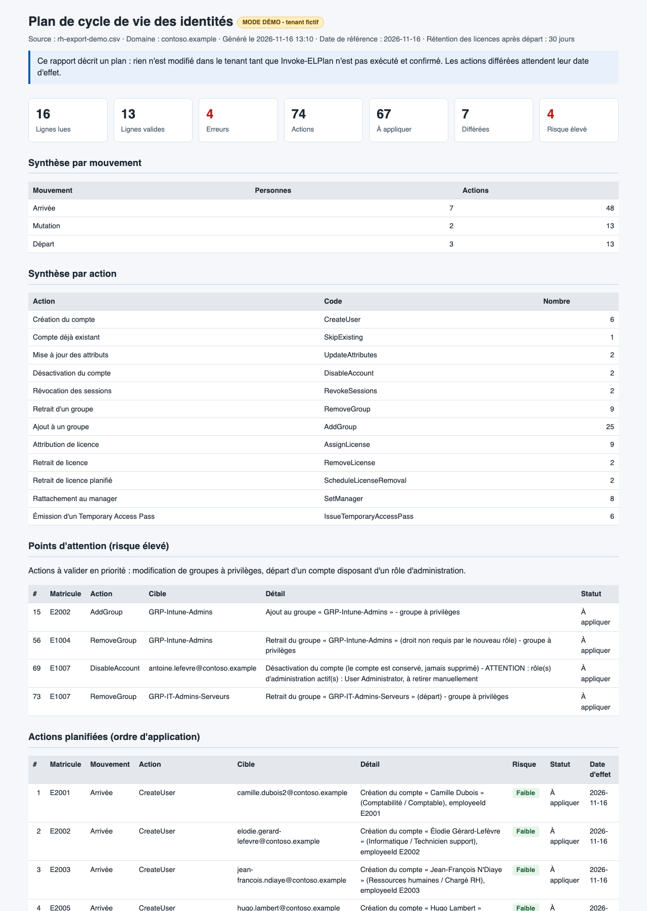

# EntraLifecycle

> Automatisation du cycle de vie des identités **Entra ID** (Joiner / Mover / Leaver) à partir d'un
> export RH CSV, avec un **plan à valider avant toute modification**, à la manière de `terraform plan`.

```powershell
$plan = Get-ELPlan -CsvPath .\export-rh.csv -ConfigPath .\config\roles.json   # lecture seule
$plan | Format-ELPlan                                                         # revue du plan
$plan | Export-ELPlanReport -OutputPath .\plan.html                           # rapport pour validation
$plan | Invoke-ELPlan -AuditLogPath .\audit\jml.jsonl                         # application confirmée
```

EntraLifecycle est un module PowerShell qui transforme les mouvements RH (arrivées, mutations,
départs) en actions Microsoft Graph : création du compte, groupes et licences selon le poste,
rattachement au manager, Temporary Access Pass pour le premier accès, retrait des droits devenus
inutiles, désactivation et révocation des sessions au départ. **Rien n'est modifié tant que le plan
n'a pas été relu puis appliqué**, et chaque action appliquée est tracée dans un journal d'audit qui
ne contient jamais de secret.



*Plan généré avec `-DemoMode` sur un tenant entièrement fictif (`contoso.example`) :
[docs/demo-report.html](docs/demo-report.html) · [docs/demo-plan.txt](docs/demo-plan.txt) ·
[docs/demo-audit.jsonl](docs/demo-audit.jsonl).*

---

## Sommaire

- [Principes](#principes)
- [Ce que fait chaque mouvement](#ce-que-fait-chaque-mouvement)
- [Exemple de plan](#exemple-de-plan)
- [Prérequis et permissions](#prérequis-et-permissions)
- [Utilisation](#utilisation)
- [Entrées : export RH et catalogue de rôles](#entrées--export-rh-et-catalogue-de-rôles)
- [Sécurité dès la conception](#sécurité-dès-la-conception)
- [Conformité : ISO 27001 et guide d'hygiène ANSSI](#conformité--iso-27001-et-guide-dhygiène-anssi)
- [Architecture](#architecture)
- [Tests et CI](#tests-et-ci)
- [Limites connues](#limites-connues)
- [Licence](#licence)

## Principes

- **Plan puis application** : `Get-ELPlan` lit le tenant avec des cmdlets `Get-Mg*` uniquement et
  produit un plan ordonné (action, cible, détail, niveau de risque, statut). `Invoke-ELPlan` est la
  seule commande qui écrit, avec confirmation (`ConfirmImpact = High`) et prise en charge de `-WhatIf`.
- **Moindre privilège** : une mutation ajoute les groupes du nouveau poste **et retire** ceux qui ne
  sont plus nécessaires ; pas d'accumulation de droits au fil des changements de fonction.
- **Jamais de suppression** : un départ désactive le compte, révoque les sessions et retire les
  groupes ; les licences sont retirées après une période de rétention configurable ; le compte est
  conservé (preuve, boîte aux lettres, réembauche).
- **Aucun secret journalisé** : le Temporary Access Pass (TAP) n'existe que dans l'objet de remise
  renvoyé à l'opérateur, sous forme de `SecureString`. Il n'apparaît ni dans le plan, ni dans le
  rapport, ni dans la console, ni dans le journal d'audit.
- **Idempotent** : l'identifiant de référence est le matricule (`employeeId`). Relancer le même
  export après une application partielle ne recrée rien : seuls les écarts restants sont planifiés.
- **Mode démo** : `-DemoMode` exécute toute la chaîne (plan, rapport, application, audit, remise du
  TAP) sur un tenant fictif, sans module Graph ni connexion.

## Ce que fait chaque mouvement

| Mouvement RH | Actions planifiées | Garde-fous |
|--------------|--------------------|------------|
| **Arrivée** (`Arrivee`) | `CreateUser` (UPN `prenom.nom` sans accents, homonymes `prenom.nom2`, `prenom.nom3`…), `AddGroup` selon le poste, `AssignLicense`, `SetManager`, `IssueTemporaryAccessPass` (usage unique, 8 h) | Compte déjà présent pour ce matricule : aucune recréation, aucun nouveau TAP, seuls les accès manquants sont complétés. Mot de passe initial aléatoire (32 caractères) jamais affiché ni stocké, changement forcé. |
| **Mutation** (`Mutation`) | `UpdateAttributes` (service, poste, pays), `RemoveGroup` des groupes du catalogue devenus inutiles, `AddGroup` des nouveaux groupes, `AssignLicense` / `RemoveLicense`, `SetManager` | Les retraits passent **avant** les ajouts. Seuls les groupes et licences gérés par le catalogue sont retirés. |
| **Départ** (`Depart`) | `DisableAccount`, `RevokeSessions`, `RemoveGroup` des groupes du catalogue, puis `RemoveLicense` une fois la rétention écoulée (sinon `ScheduleLicenseRemoval` avec la date prévue) | Jamais de suppression du compte. Rôle d'administration encore actif : risque **Élevé** et alerte de retrait manuel. Appartenances hors catalogue signalées pour revue. |

Toute action dont la date d'effet est future est **différée** : elle figure au plan mais n'est
jamais envoyée à Graph avant sa date. L'ajout ou le retrait d'un groupe déclaré « à privilèges »
est classé à risque **Élevé** et remonté en tête du rapport.

## Exemple de plan

Extrait de `Format-ELPlan` sur l'export de démonstration ([sortie complète](docs/demo-plan.txt)) :

```text
EntraLifecycle - plan rh-export-demo.csv (domaine contoso.example, date de référence 2026-11-16) [MODE DÉMO - tenant fictif]
Symboles : + création/ajout, ~ modification, - retrait/révocation, . information, (!) risque élevé

  # E2001 - Arrivée - camille.dubois2@contoso.example
  + CreateUser                 camille.dubois2@contoso.example
  + AddGroup                   GRP-Tous-Collaborateurs
  + AddGroup                   GRP-Finance-Comptabilite
  + AddGroup                   GRP-App-Sage
  + AssignLicense              SPE_E3
  ~ SetManager                 sophie.martin@contoso.example
  + IssueTemporaryAccessPass   camille.dubois2@contoso.example

  # E2004 - Arrivée - chloe.rousseau@contoso.example
  + CreateUser                 chloe.rousseau@contoso.example           (différé au 2026-12-01)
  ~ SetManager                 E2005                                    (différé au 2026-12-01)
  ...

  # E1004 - Mutation - karim.haddad@contoso.example
  ~ UpdateAttributes           karim.haddad@contoso.example
  - RemoveGroup                GRP-IT-Support
  - RemoveGroup                GRP-Intune-Admins                        (!)
  + AddGroup                   GRP-Ventes
  + AddGroup                   GRP-App-CRM
  + AssignLicense              SPE_F1
  - RemoveLicense              SPE_E3
  ~ SetManager                 marc.leroy@contoso.example

  # E1006 - Départ - lucas.girard@contoso.example
  - DisableAccount             lucas.girard@contoso.example
  - RevokeSessions             lucas.girard@contoso.example
  - RemoveGroup                GRP-Tous-Collaborateurs
  - RemoveGroup                GRP-Ventes
  - RemoveGroup                GRP-App-CRM
  . ScheduleLicenseRemoval     SPE_F1                                   (retrait le 2026-12-13)

Erreurs (lignes non traitées) (4) :
  ! ligne 14 [E2008] Service/Poste absent du catalogue des rôles : « Marketing / Community manager »
  ! ligne 15 [E2009] Date d'effet invalide « 16/11/2026 » (format attendu : aaaa-MM-jj)
  ! ligne 16 [E2010' or 1 eq 1] Matricule invalide « E2010' or 1 eq 1 » (lettres, chiffres, tiret ou souligné, 32 caractères maximum)
  ! ligne 17 [E9999] Mutation impossible : aucun compte ne porte l'employeeId E9999 (vérifier l'export RH ou traiter comme une arrivée)

Avertissements (2) :
  ! ligne 4 [E2003] Groupe « GRP-App-SIRH » introuvable dans le tenant : ajout ignoré
  ! ligne 12 [E1006] 1 appartenance(s) hors catalogue conservée(s) sur le compte désactivé : revue manuelle par les propriétaires des groupes

Plan : 46 à créer/ajouter, 10 à modifier, 15 à retirer/révoquer (7 différée(s), 4 à risque élevé) ; 4 erreur(s), 2 avertissement(s).
Rien n'est modifié tant que Invoke-ELPlan n'est pas exécuté et confirmé.
```

On y retrouve les homonymes (`camille.dubois` existe déjà dans le tenant, deux nouvelles Camille
Dubois arrivent dans le même export), une arrivée future rattachée à un manager créé par le même
plan, une mutation qui **retire** un groupe à privilèges, un départ dont la licence est conservée
30 jours, et une tentative d'injection OData dans le matricule rejetée à la validation.

## Prérequis et permissions

| Élément | Détail |
|---------|--------|
| PowerShell | Windows PowerShell 5.1 ou PowerShell 7.2+ |
| Mode réel | SDK `Microsoft.Graph` (`Authentication`, `Users`, `Groups`, `Identity.DirectoryManagement`, `Users.Actions`, `Identity.SignIns`) |
| Tenant | Stratégie de méthode d'authentification **Temporary Access Pass** activée pour les nouveaux comptes |
| Mode démo | Aucun module externe, aucune connexion |

Scopes Microsoft Graph délégués :

| Étape | Scopes | Rôle Entra minimal suggéré |
|-------|--------|----------------------------|
| Plan (`Get-ELPlan`, lecture seule) | `User.Read.All`, `GroupMember.Read.All`, `Organization.Read.All` | Lecteur global |
| Application (`Invoke-ELPlan`) | `User.ReadWrite.All`, `GroupMember.ReadWrite.All`, `LicenseAssignment.ReadWrite.All`, `User.RevokeSessions.All`, `UserAuthenticationMethod.ReadWrite.All` | Administrateur des utilisateurs + Administrateur des licences + Administrateur de l'authentification |

Séparer les deux étapes permet une **séparation des tâches** : un gestionnaire IAM génère et fait
valider le plan avec un compte en lecture seule, l'application est faite par un compte habilité
(idéalement activé via PIM le temps de l'opération).

## Utilisation

```powershell
Import-Module .\EntraLifecycle\EntraLifecycle.psd1

# 1. Démonstration complète sans tenant : plan texte, rapport HTML, application et audit dans .\docs
pwsh .\scripts\Invoke-Demo.ps1

# 2. Plan réel (lecture seule) et revue
Connect-MgGraph -Scopes 'User.Read.All', 'GroupMember.Read.All', 'Organization.Read.All'
$plan = Get-ELPlan -CsvPath .\export-rh.csv -ConfigPath .\config\roles.json
$plan | Format-ELPlan
$plan.Errors   | Format-Table Ligne, Matricule, Message
$plan.Actions  | Where-Object Risk -eq 'Élevé' | Format-Table Order, Matricule, Action, Target, Detail
$plan | Export-ELPlanReport -OutputPath .\plan-a-valider.html

# 3. Simulation puis application (une confirmation par action, ou -Confirm:$false après validation)
Connect-MgGraph -Scopes 'User.ReadWrite.All', 'GroupMember.ReadWrite.All', 'LicenseAssignment.ReadWrite.All',
                        'User.RevokeSessions.All', 'UserAuthenticationMethod.ReadWrite.All'
$plan | Invoke-ELPlan -WhatIf
$result = $plan | Invoke-ELPlan -AuditLogPath .\audit\jml-2026-11.jsonl
$result.Results | Where-Object Result -ne 'Succès' | Format-Table Order, Matricule, Action, Target, Result, Error

# 4. Remise des TAP aux managers, un par un, par un canal sûr (jamais par e-mail en clair)
$handoff = $result.Handoffs | Where-Object Matricule -eq 'E2001'
[pscredential]::new('tap', $handoff.TemporaryAccessPass).GetNetworkCredential().Password
```

| Commande | Rôle | Écrit dans le tenant |
|----------|------|----------------------|
| `Get-ELPlan` | Valide l'export et le catalogue, lit le tenant, calcule le plan (`-DemoMode`, `-ReferenceDate`) | Non |
| `Format-ELPlan` | Rendu texte du plan, façon `terraform plan` | Non |
| `Export-ELPlanReport` | Rapport HTML autonome à faire valider | Non |
| `Invoke-ELPlan` | Applique le plan action par action, écrit l'audit, renvoie les TAP | Oui (sauf `-WhatIf` et plans démo) |

`Invoke-ELPlan` renvoie `RunId`, `Succeeded`, `Failed`, `AuditLogPath`, `Results` (une ligne par
action : `Succès`, `Échec`, `Annulé`, `Différé`, `Planifié`, `Ignoré`, `Non appliqué`) et `Handoffs`.
Une erreur sur une action est isolée et n'interrompt pas les autres ; si la création d'un compte
échoue, toutes ses actions suivantes (et le rattachement des collaborateurs dont il est le manager)
sont annulées.

## Entrées : export RH et catalogue de rôles

**Export RH** (`samples/rh-export-demo.csv`) : UTF-8 (avec ou sans BOM) ou Windows-1252 (export
Excel), séparateur `;` ou `,` détecté automatiquement.

| Colonne | Obligatoire | Format |
|---------|-------------|--------|
| `Matricule` | Oui | `[A-Za-z0-9_-]`, 32 caractères max (stocké dans `employeeId`) |
| `Prenom`, `Nom` | Oui | 64 caractères max, sans `< > " @ ; =` ni caractère de contrôle |
| `Service`, `Poste` | Arrivée / mutation | Couple présent dans le catalogue (casse et accents ignorés) |
| `Manager` | Non | Matricule du manager (compte existant ou arrivée du même export) |
| `DateEffet` | Oui | `aaaa-MM-jj` |
| `Mouvement` | Oui | `Arrivee` / `Arrivée`, `Mutation`, `Depart` / `Départ` |

Une ligne invalide devient une **erreur de plan** (avec son numéro de ligne) et n'est pas traitée ;
seuls un fichier absent ou des colonnes manquantes arrêtent l'exécution.

**Catalogue de rôles** (`config/roles.json`) :

```json
{
  "settings": {
    "upnDomain": "contoso.example",
    "leaverLicenseRetentionDays": 30,
    "defaultUsageLocation": "FR",
    "privilegedGroups": ["GRP-IT-Admins-Serveurs", "GRP-Intune-Admins"]
  },
  "roles": [
    {
      "service": "Comptabilité",
      "poste": "Contrôleur de gestion",
      "groups": ["GRP-Tous-Collaborateurs", "GRP-Finance-Comptabilite", "GRP-Finance-Controle", "GRP-App-PowerBI"],
      "licenses": ["SPE_E3", "POWER_BI_PRO"]
    }
  ]
}
```

`groups` contient des noms d'affichage de groupes (uniques dans le tenant), `licenses` des
`skuPartNumber`. Champs optionnels par rôle : `department`, `jobTitle`, `usageLocation`.
Le catalogue est validé intégralement au chargement (domaine, rétention 0–3650 jours, doublons
Service/Poste, listes vides…) avec un message listant tous les problèmes.

## Sécurité dès la conception

| Risque | Mesure |
|--------|--------|
| Modification non maîtrisée du tenant | Séparation plan / application, `ConfirmImpact = High`, `-WhatIf`, avertissement si le plan a plus de 24 h, refus d'un objet qui n'est pas un plan |
| Fuite du TAP ou du mot de passe initial | TAP renvoyé uniquement en `SecureString` en lecture seule ; mot de passe initial aléatoire (CSPRNG) jamais stocké ; le plan, le rapport et l'audit n'en contiennent aucun (vérifié par les tests) |
| Journal d'audit incomplet ou bavard | JSONL en ajout seul, liste blanche de champs (`timestamp`, `runId`, `mode`, `actor`, `matricule`, `action`, `target`, `result`, `error`…), marqueurs de début et de fin ; si le journal n'est pas inscriptible, **aucune action n'est appliquée** |
| Accumulation de droits (mutations) | Retrait des groupes et licences du catalogue non requis par le nouveau poste, avant les ajouts |
| Compte orphelin ou réactivable | Départ : désactivation + révocation des jetons, retrait des groupes, alerte sur les rôles d'administration et les appartenances hors catalogue |
| Injection via l'export RH | Matricules en liste blanche stricte et échappement OData ; rapport HTML entièrement encodé, sans script, avec CSP `default-src 'none'` |
| Mauvais compte modifié | Rapprochement par `employeeId` ; plusieurs comptes avec le même matricule bloquent la ligne |
| Données personnelles | Les exports RH, plans et journaux réels sont exclus du dépôt (`.gitignore`) ; seules les données fictives de démo sont versionnées |

## Conformité : ISO 27001 et guide d'hygiène ANSSI

EntraLifecycle outille les exigences de gestion des identités et des accès ; il ne remplace ni la
politique, ni la validation humaine du plan.

| Référentiel | Exigence | Apport d'EntraLifecycle |
|-------------|----------|-------------------------|
| ISO/IEC 27001:2022 A.5.15 | Contrôle d'accès | Droits dérivés d'un catalogue Service/Poste versionné, appliqués de façon reproductible |
| ISO/IEC 27001:2022 A.5.16 | Gestion des identités | Une identité nominative par matricule, cycle de vie complet arrivée → mutation → départ, aucune suppression |
| ISO/IEC 27001:2022 A.5.17 | Informations d'authentification | TAP à usage unique et durée limitée, mot de passe initial aléatoire jamais divulgué, changement forcé |
| ISO/IEC 27001:2022 A.5.18 | Droits d'accès | Attribution, modification et retrait des droits tracés et validés avant application |
| ISO/IEC 27001:2022 A.6.5 | Responsabilités après la fin ou le changement d'emploi | Désactivation et révocation des sessions au départ, retrait des droits à la mutation |
| ISO/IEC 27001:2022 A.8.2 | Droits d'accès à privilèges | Groupes à privilèges et rôles d'administration signalés à risque élevé |
| ISO/IEC 27001:2022 A.8.15 | Journalisation | Journal JSONL horodaté (UTC), acteur, résultat et erreur de chaque action |
| ISO/IEC 27001:2022 A.5.3 | Séparation des tâches | Plan en lecture seule relu par un tiers avant application par un compte habilité |
| ANSSI, mesure 6 | Organiser les procédures d'arrivée, de départ et de changement de fonction des utilisateurs | Cœur du module : procédure JML outillée et systématique |
| ANSSI, mesure 8 | Identifier nommément chaque personne accédant au système | Comptes nominatifs liés au matricule RH, homonymes distingués |
| ANSSI, mesure 9 | Attribuer les bons droits sur les ressources sensibles | Moindre privilège, retrait des droits devenus inutiles |
| ANSSI, mesures 10 et 11 | Règles de mots de passe, protection des mots de passe stockés | Mot de passe aléatoire de 32 caractères jamais stocké ni journalisé |
| ANSSI, mesure 13 | Privilégier une authentification forte | Premier accès par TAP pour enrôler directement MFA / sans mot de passe |
| ANSSI, « Superviser, auditer, réagir » | Journalisation des opérations | Piste d'audit exploitable (SIEM, revue périodique des accès) |

Références : [ISO/IEC 27001:2022](https://www.iso.org/standard/27001) ·
[Guide d'hygiène informatique de l'ANSSI](https://cyber.gouv.fr/publications/guide-dhygiene-informatique).

## Architecture

```
EntraLifecycle/
├── EntraLifecycle/                    # Module PowerShell
│   ├── EntraLifecycle.psd1 / .psm1
│   ├── Public/                        # Get-ELPlan, Format-ELPlan, Export-ELPlanReport, Invoke-ELPlan
│   ├── Private/
│   │   ├── Core/                      # Constantes, objets du plan, normalisation de texte
│   │   ├── Input/                     # Lecture et validation de l'export RH et du catalogue
│   │   ├── Identity/                  # Génération d'UPN (accents, homonymes, longueur)
│   │   ├── Tenant/                    # Instantané du tenant : Graph (Get-Mg*) ou fixture démo
│   │   ├── Planning/                  # Moteur de plan pur : arrivées, mutations, départs
│   │   ├── Apply/                     # Écritures Graph, exécuteur démo, audit, secrets
│   │   └── Report/                    # Rendus HTML et texte
│   └── Data/demo-tenant.json          # Tenant fictif du mode démo
├── config/roles.json                  # Catalogue de rôles d'exemple
├── samples/rh-export-demo.csv         # Export RH fictif
├── scripts/                           # Invoke-Demo.ps1, Invoke-Validation.ps1
├── tests/                             # Tests Pester 5 (Graph simulé)
├── docs/                              # Rapport, plan et audit de démonstration
└── .github/workflows/ci.yml           # Pester (Linux, Windows, PowerShell 5.1) + PSScriptAnalyzer + démo
```

Le moteur de plan est une **fonction pure** de (lignes RH validées, catalogue, instantané du tenant,
date de référence) : il n'appelle jamais Graph. Le mode réel et le mode démo produisent le même
instantané, ce qui garantit que la logique testée est celle exécutée en production.

## Tests et CI

```powershell
Install-Module Pester -MinimumVersion 5.5.0 -Scope CurrentUser -Force -SkipPublisherCheck
Invoke-Pester -Path .\tests -Output Detailed

# ou, en une commande : lint + tests + docs/ (rapport, plan, audit) + capture si Chrome est installé
pwsh .\scripts\Invoke-Validation.ps1 -InstallPester
```

125 tests couvrent : la translittération et la génération d'UPN (accents, ligatures, apostrophes,
homonymes, longueur maximale), la validation de l'export RH (colonnes, encodages, séparateurs,
dates, matricules hostiles, doublons) et du catalogue, la planification de chaque mouvement
(ordre, moindre privilège, rétention des licences, actions différées, risques), l'application
contre un Graph simulé (isolation des erreurs, annulation en cascade, `-WhatIf`, audit
inaccessible), l'absence du TAP dans l'audit, les résultats, le plan et le rapport, l'encodage HTML
et la démo de bout en bout. La CI exécute la suite sous Linux, Windows (PowerShell 7) et
**Windows PowerShell 5.1**, passe PSScriptAnalyzer et publie le rapport de démo en artefact.

## Limites connues

- **Comptes cloud uniquement** : en environnement hybride, les comptes synchronisés depuis AD
  (Entra Connect) doivent être gérés côté AD ; le module ne crée que des comptes cloud.
- **Retrait des licences différé** : il n'y a pas d'ordonnanceur intégré, il faut relancer le plan
  (tâche planifiée, Azure Automation) pour que `ScheduleLicenseRemoval` devienne `RemoveLicense`.
- **Groupes** : seuls les groupes du catalogue sont gérés, par nom d'affichage unique, en
  appartenance directe ; les groupes dynamiques et la licence par groupe ne sont pas pilotés.
- **Rôles d'administration** : ils sont détectés (attributions actives) et signalés, jamais retirés
  automatiquement ; les attributions PIM éligibles ne sont pas lues.
- **Unicité des UPN** : vérifiée sur les `userPrincipalName` du tenant ; les collisions d'alias de
  messagerie (`proxyAddresses`) ne sont pas contrôlées.
- **Réembauche** : un compte désactivé retrouvé pour une arrivée n'est pas réactivé automatiquement
  (avertissement pour validation manuelle).
- **Throttling Graph** : pas de nouvelle tentative automatique ; une action en échec est journalisée
  et sera replanifiée au prochain passage (idempotence).

## Licence

Distribué sous licence [MIT](LICENSE) — © 2026 Papa Mamadou Gueye.
